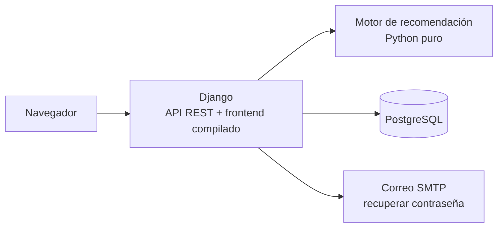

# parejo

Aplicación web que organiza encuentros de pádel amateur: registra nivel, disponibilidad y preferencias de los jugadores, recomienda participantes compatibles y arma parejas equilibradas (2 vs 2).
Es el prototipo del Trabajo Final de Grado de Ingeniería de Software, la pieza central es el motor de recomendación y balanceo.

## Arquitectura



Una sola aplicación Django (monolito modular) con una sola base de datos; la autenticación usa sesiones con cookie y CSRF. El motor no conoce Django ni la base: recibe datos simples y devuelve resultados. En desarrollo, el frontend lo sirve Vite, que redirige `/api` a Django.

## Estructura

```
parejo/
├── backend/
│   ├── config/       # settings y rutas de Django
│   ├── apps/         # módulos: usuarios, localidades, encuentros y comun (errores y utilidades)
│   ├── motor/        # motor de recomendación y equilibrio, sin imports de Django
│   ├── evaluacion/   # dataset de demostración, generadores, oráculo, experimentos y resultados
│   └── tests/        # tests de pytest, en espejo de las apps
├── frontend/         # SPA en React + Vite (código en src/)
├── docs/             # requisitos: historias de usuario, modelo, esquema y pantallas
├── .claude/          # reglas de trabajo para Claude Code
└── CLAUDE.md         # resumen del proyecto y reglas generales
```

## Requisitos

- Python 3.13
- PostgreSQL 17
- Node.js 22.12 o superior (con npm)
- Git

## Instalación

Los comandos son para PowerShell.

**1. Clonar el repositorio**

```powershell
git clone https://github.com/IgnacioRomero17/parejo.git
cd parejo
```

**2. Crear la base de datos**

```powershell
createdb -U postgres parejo
```

También se puede crear desde psql o pgAdmin con `CREATE DATABASE parejo;`.

**3. Entorno virtual y dependencias del backend**

```powershell
cd backend
py -3.13 -m venv .venv
.\.venv\Scripts\Activate.ps1
pip install -r requirements-dev.txt
```

Si PowerShell no deja activar el entorno, ejecutar una vez `Set-ExecutionPolicy -Scope CurrentUser RemoteSigned`.

**4. Archivo `.env`**

```powershell
Copy-Item .env.example .env
python -c "import secrets; print(secrets.token_urlsafe(50))"
```

Pegar la clave generada en `DJANGO_SECRET_KEY` y completar la contraseña de PostgreSQL. `token_urlsafe` solo usa letras, números, `-` y `_`, así que la clave no trae caracteres como `#` o `=` que confundan al leer el `.env`.

| Variable | Obligatoria | Para qué sirve |
|---|---|---|
| `DJANGO_SECRET_KEY` | sí | clave secreta de Django (sesiones y tokens) |
| `DJANGO_DEBUG` | no | modo de depuración; `True` en desarrollo |
| `DB_NAME` | no | nombre de la base (por defecto `parejo`) |
| `DB_USER` | sí | usuario de PostgreSQL |
| `DB_PASSWORD` | sí | contraseña de ese usuario |
| `DB_HOST` / `DB_PORT` | no | servidor y puerto de PostgreSQL (por defecto `localhost` y `5432`) |
| `URL_FRONTEND` | no | base de los enlaces de los correos (por defecto `http://localhost:5173`) |
| `EMAIL_BACKEND` | no | sin definir, los correos se muestran en la consola; con el backend SMTP se envían de verdad |
| `EMAIL_HOST`, `EMAIL_PORT`, `EMAIL_HOST_USER`, `EMAIL_HOST_PASSWORD`, `EMAIL_USE_TLS` | solo con SMTP | servidor y credenciales de correo (`EMAIL_HOST` es obligatoria en ese caso) |
| `DEFAULT_FROM_EMAIL` | no | remitente de los correos |

**5. Base, localidades, datos de demostración y superusuario**

```powershell
python manage.py migrate
python manage.py loaddata localidades
python manage.py cargar_datos
python manage.py createsuperuser
```

`createsuperuser` pide correo, nombre, apellido y contraseña.

**6. Dependencias del frontend**

```powershell
cd ..\frontend
npm install
```

## Cómo levantarlo

Terminal 1, backend:

```powershell
cd backend
.\.venv\Scripts\Activate.ps1
python manage.py runserver
```

Terminal 2, frontend:

```powershell
cd frontend
npm run dev
```

| Dirección | Qué es |
|---|---|
| http://localhost:5173 | la aplicación |
| http://localhost:8000/api/ | la API |
| http://localhost:8000/admin/ | el admin de Django (con el superusuario) |

El correo de recuperación de contraseña aparece en la terminal del backend.

## Jugadores de demostración

`cargar_datos` crea 24 jugadores con perfil completo, por ejemplo `tomas.rios@demo.parejo.example`, todos con la contraseña `parejo2026`. Para devolverlos a los datos del archivo: `python manage.py cargar_datos --reemplazar` (no toca a los demás usuarios).

## Tests

Backend, desde `backend/` con el entorno activo: `pytest`, `ruff check .` y `ruff format --check .` (pytest crea su propia base de test en PostgreSQL, así que el usuario de `DB_USER` necesita permiso para crear bases). Frontend, desde `frontend/`: `npm test` y `npm run lint`.

## Evaluación del motor

Desde `backend/`: `python -m evaluacion.experimentos` regenera los CSV y el `resumen.md` de `evaluacion/resultados/`. Con la semilla fija 2026, los resultados son idénticos en cada corrida, salvo los tiempos de rendimiento, que dependen de la máquina.
