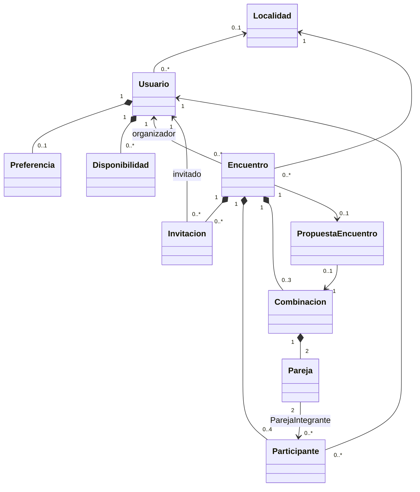

# Modelo de clases — prototipo parejo

Qué datos maneja el sistema y qué significa cada uno. La definición técnica exacta (tipos, claves, restricciones) está en `docs/esquema.sql`; si este archivo y el SQL difieren en algo técnico, manda el SQL y se avisa al autor.

## Convenciones de implementación (Django)

- Una app por dominio: `usuarios` (Usuario, Preferencia, Disponibilidad), `localidades` (Localidad), `encuentros` (el resto).
- Nombres de tablas y columnas **iguales al DER**: `db_table` en cada modelo y `db_column` cuando el nombre del campo difiere.
- Claves primarias con el nombre del DER (`id_usuario`, `id_encuentro`, …) como `AutoField(primary_key=True)`.
- Enumeraciones con `models.TextChoices` (`IntegerChoices` para el día de la semana): el **código** se guarda en la base, la **etiqueta** se muestra en la interfaz.
- Fechas y horas con zona horaria (`USE_TZ = True`, `America/Argentina/Cordoba`). Los `TIMESTAMP` del DER se guardan como `timestamp with time zone`.
- Las restricciones `CHECK` y `UNIQUE` de `esquema.sql` se declaran en `Meta.constraints` para que formen parte de las migraciones.
- Las reglas que cuentan filas o dependen de la fecha actual se validan en la capa de servicio, no en la base.
- Composición en el diagrama = borrado en cascada. El prototipo no borra usuarios ni encuentros desde la app.

## Enumeraciones

| Enumeración | Código (base) | Etiqueta (interfaz) |
|---|---|---|
| TipoEncuentro | `RECREATIVO` · `COMPETITIVO` · `INDIFERENTE` | Recreativo · Competitivo · Indiferente |
| LadoPreferido | `DRIVE` · `REVES` · `INDIFERENTE` | Drive · Revés · Indiferente |
| DiaSemana | `1` … `7` | Lunes … Domingo (1 = lunes, ISO 8601) |
| EstadoEncuentro | `CREADO` · `BUSCANDO_PARTICIPANTES` · `COMPLETO` · `PROPUESTA_GENERADA` | Creado · Buscando participantes · Completo · Propuesta generada |
| EstadoInvitacion | `PENDIENTE` · `ACEPTADA` · `RECHAZADA` | Pendiente · Aceptada · Rechazada |
| Genero | `MASCULINO` · `FEMENINO` · `NO_DECLARA` | Masculino · Femenino · Prefiero no decirlo |
| FrecuenciaJuego | `MENOS_1_SEMANA` · `1_SEMANA` · `2_3_SEMANA` · `4_MAS_SEMANA` | Menos de 1 vez por semana · 1 vez por semana · 2 o 3 veces por semana · 4 o más veces por semana |

Genero y FrecuenciaJuego no figuran como enumeraciones en el diagrama (son `String`), pero se implementan así para validar los valores.

## Clases

### Usuario
Modelo de usuario personalizado (`AbstractBaseUser` + `PermissionsMixin`). Tabla `usuario`.

| Atributo | Columna | Obligatorio | Regla |
|---|---|---|---|
| idUsuario | id_usuario | sí | PK |
| email | email | sí | único, guardado en minúsculas; es el `USERNAME_FIELD` |
| passwordHash | password_hash | sí | campo `password` de Django con `db_column="password_hash"` |
| nombre, apellido | nombre, apellido | sí | hasta 60 caracteres |
| edad | edad | al completar onboarding | entero de 18 a 99 |
| genero | genero | al completar onboarding | enumeración Genero |
| frecuenciaJuego | frecuencia_juego | al completar onboarding | enumeración FrecuenciaJuego |
| nivelEstimado | nivel_estimado | al completar onboarding | 1,0 a 7,0, múltiplo de 0,5 |
| localidad | id_localidad | al completar onboarding | FK a Localidad |
| disponibleParaInvitaciones | disponible_para_invitaciones | sí | por defecto falso |
| activo | activo | sí | campo `is_active` de Django con `db_column="activo"`; por defecto verdadero |
| fechaRegistro | fecha_registro | sí | se completa al crear |

- **Perfil completo** = nivel y localidad no nulos. Es condición para ser recomendado y para crear encuentros.
- Django agrega `last_login`, `is_staff` e `is_superuser`, que no están en el DER. Se aceptan: los necesita el panel de administración, que se usa para cargar el dataset de demostración.

### Localidad
Catálogo cerrado. Tabla `localidad`. Atributos: `nombre` (único), `latitud`, `longitud` (6 decimales).
- Se carga con un fixture (ver catálogo al final). No hay pantalla para editarlo.

### Preferencia
Tabla `preferencia`. Un usuario tiene 0 o 1 preferencia; se crea en el onboarding paso 2.
- `tipoEncuentro` (TipoEncuentro) y `ladoPreferido` (LadoPreferido), ambos obligatorios.

### Disponibilidad
Tabla `disponibilidad`. Un usuario tiene 0 o más franjas.
- `diaSemana`, `horaInicio`, `horaFin`. Pasos de 30 minutos, al menos 60 minutos, sin cruzar medianoche.
- Al guardar, las franjas del mismo día superpuestas o contiguas se unen (lógica del backend).

### Encuentro
Tabla `encuentro`.
- `organizador` (FK a Usuario), `fecha`, `horaInicio`, `duracionMinutos` (60, 90 o 120), `localidad` (FK, obligatoria), `ubicacion` (dirección informativa, hasta 150 caracteres), `tipoEncuentro`, `estado` (por defecto `CREADO`), `fechaCreacion`.
- Hora de inicio en pasos de 30 minutos. Inicio + duración termina a las 23:30 como máximo. La fecha y hora no pueden ser pasadas (validación del backend).
- El organizador se registra también como Participante al crear el encuentro.

### Invitacion
Tabla `invitacion`. Composición de Encuentro.
- `encuentro`, `usuarioInvitado`, `estado` (por defecto `PENDIENTE`), `fechaEnvio`, `fechaRespuesta`.
- Único por (encuentro, usuario invitado). `fechaRespuesta` es nula solo mientras está pendiente.

### Participante
Tabla `participante`. Composición de Encuentro. Máximo 4 por encuentro (validación del backend).
- `encuentro`, `usuario`, `fechaConfirmacion`. Único por (encuentro, usuario).

### Combinacion
Tabla `combinacion`. Composición de Encuentro; se crean las 3 juntas al formar parejas.
- `puntajeEquilibrio` (0 a 1, cuatro decimales), `fechaEvaluacion`.
- No tiene columna de número: el número de combinación (1, 2, 3) es su orden por `id_combinacion` dentro del encuentro. El servicio las guarda en el orden del motor, en la misma transacción.

### Pareja
Tabla `pareja`. Composición de Combinacion: cada combinación tiene exactamente 2 parejas (`numero` 1 y 2).

### ParejaIntegrante
Tabla `pareja_integrante`. Relación entre Pareja y Participante: cada pareja tiene exactamente 2 participantes.
- Clave primaria compuesta (`id_pareja`, `id_participante`), como en el DER. Se implementa con `models.CompositePrimaryKey` (requiere Django 5.2 o superior), definida desde la primera migración.
- No se registra en el panel de administración (Django no lo soporta para claves compuestas).

### PropuestaEncuentro
Tabla `propuesta_encuentro`. 0 o 1 por encuentro.
- `encuentro` (único), `combinacion` elegida (única), `fechaGeneracion`.
- El puntaje de equilibrio se obtiene de la combinación elegida; no se duplica.

## Relaciones

| Relación | Multiplicidad | Tipo |
|---|---|---|
| Usuario — Preferencia | 1 — 0..1 | composición |
| Usuario — Disponibilidad | 1 — 0..* | composición |
| Localidad — Usuario | 0..1 — 0..* | asociación |
| Localidad — Encuentro | 1 — 0..* | asociación |
| Usuario (organizador) — Encuentro | 1 — 0..* | asociación |
| Usuario — Invitacion | 1 — 0..* | asociación |
| Usuario — Participante | 1 — 0..* | asociación |
| Encuentro — Invitacion | 1 — 0..* | composición |
| Encuentro — Participante | 1 — 0..4 | composición |
| Encuentro — Combinacion | 1 — 0..3 | composición |
| Combinacion — Pareja | 1 — 2 | composición |
| Pareja — Participante | 2 — 0..* | asociación (vía ParejaIntegrante) |
| Encuentro — PropuestaEncuentro | 1 — 0..1 | asociación |
| PropuestaEncuentro — Combinacion | 0..1 — 1 | asociación |

## Métodos del diagrama y dónde se implementan

Los métodos del diagrama describen responsabilidades. No todos van como métodos del modelo: la lógica de recomendación y equilibrio vive en `backend/motor/` (Python puro) y la coordinación, en la capa de servicio.

| Método del diagrama | Implementación |
|---|---|
| Usuario.registrar, iniciarSesion, recuperarContrasena | vistas de la API con el sistema de autenticación de Django |
| Usuario.actualizarPerfil, Preferencia.actualizar | servicio de usuarios + serializers |
| Usuario.crearEncuentro, Encuentro.crear | servicio de encuentros (crea encuentro + participante organizador) |
| Encuentro.recomendarCandidatos | servicio de encuentros → `motor.recomendar` |
| Encuentro.lugaresLibres, estaCompleto | métodos del modelo Encuentro |
| Encuentro.calcularNivelPromedio | dentro de `motor.recomendar` (recibe los niveles de los confirmados) |
| Encuentro.evaluarCombinaciones, Combinacion.calcularEquilibrio | servicio de encuentros → `motor.equilibrio` |
| Encuentro.generarPropuesta | servicio de encuentros (guarda combinaciones, parejas y propuesta en una transacción) |
| Invitacion.aceptar, rechazar, estaPendiente | servicio de invitaciones (aceptar crea el Participante) |
| Disponibilidad.cubriria | `motor.filtros` (recibe datos simples, no el modelo) |
| Localidad.distanciaKm | `motor.geo.haversine_km` |
| PropuestaEncuentro.obtenerPuntajeEquilibrio, obtenerResumen | serializer de la propuesta |

## Vista general

## Catálogo de localidades (fixture)

Coordenadas **aproximadas, a verificar** por el autor antes de cargarlas.

| Nombre | Latitud | Longitud |
|---|---|---|
| Río Ceballos | -31.166700 | -64.316700 |
| Salsipuedes | -31.137222 | -64.295833 |
| Unquillo | -31.233300 | -64.316700 |
| Mendiolaza | -31.265000 | -64.303100 |
| Villa Allende | -31.294400 | -64.295300 |
| Saldán | -31.316900 | -64.308600 |
| La Calera | -31.343900 | -64.335300 |
| Colonia Caroya | -31.021300 | -64.061300 |
| Jesús María | -30.981700 | -64.094200 |
| Villa Carlos Paz | -31.415901 | -64.489469 |
| Malagueño | -31.463900 | -64.357500 |
| Córdoba – Nueva Córdoba | -31.426111 | -64.185806 |
| Córdoba – Centro | -31.416700 | -64.183300 |
| Córdoba – Alta Córdoba | -31.389200 | -64.184200 |
| Córdoba – Cerro de las Rosas | -31.368000 | -64.233000 |
| Córdoba – Argüello | -31.346944 | -64.253333 |
